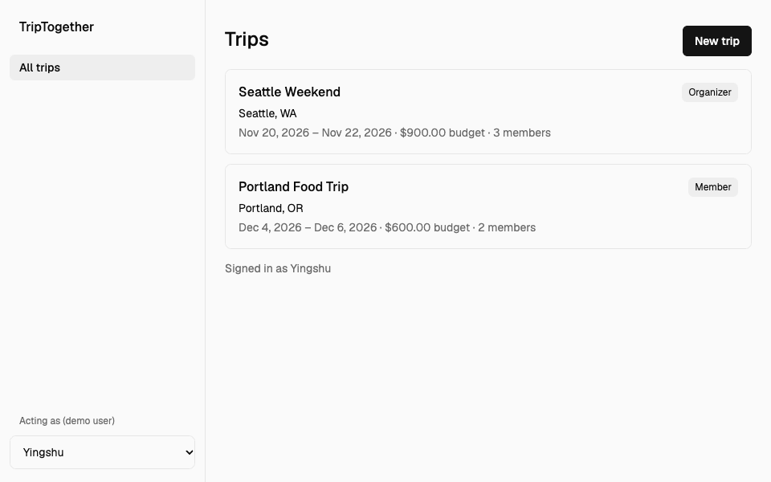
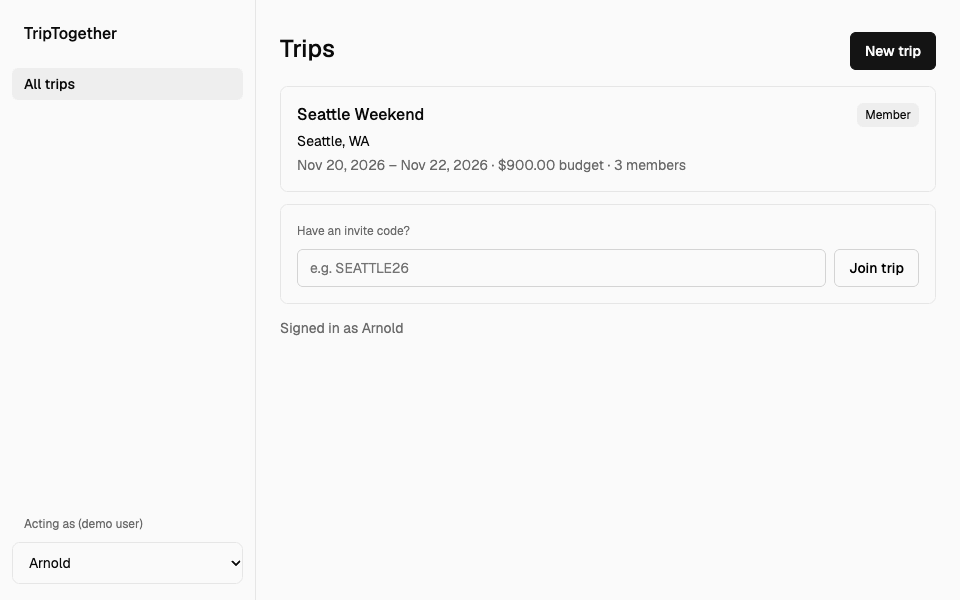
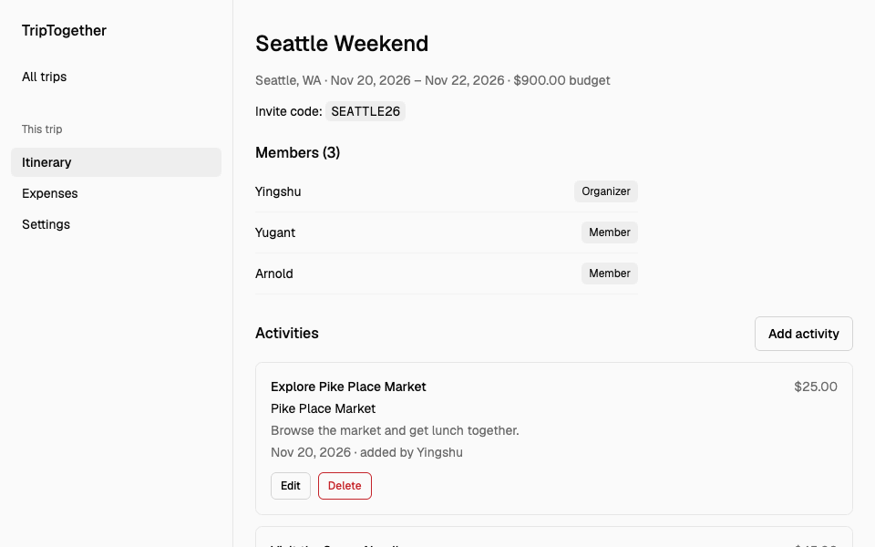
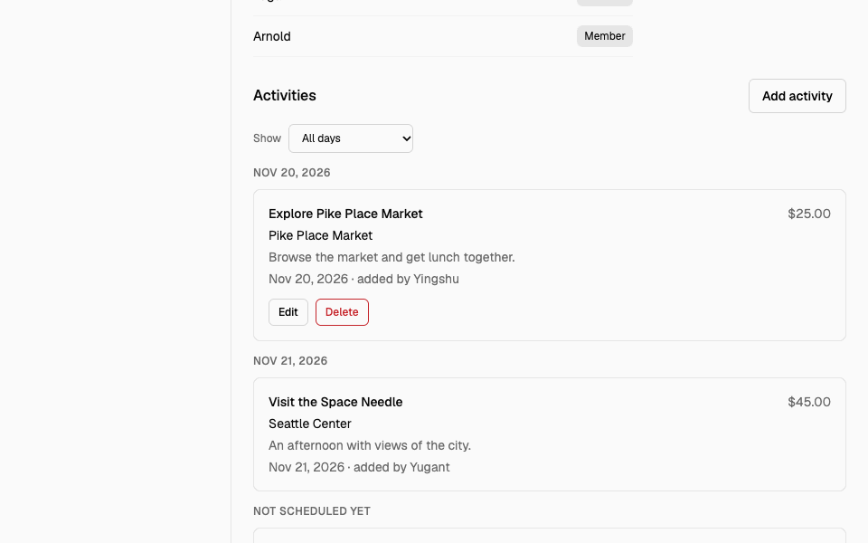
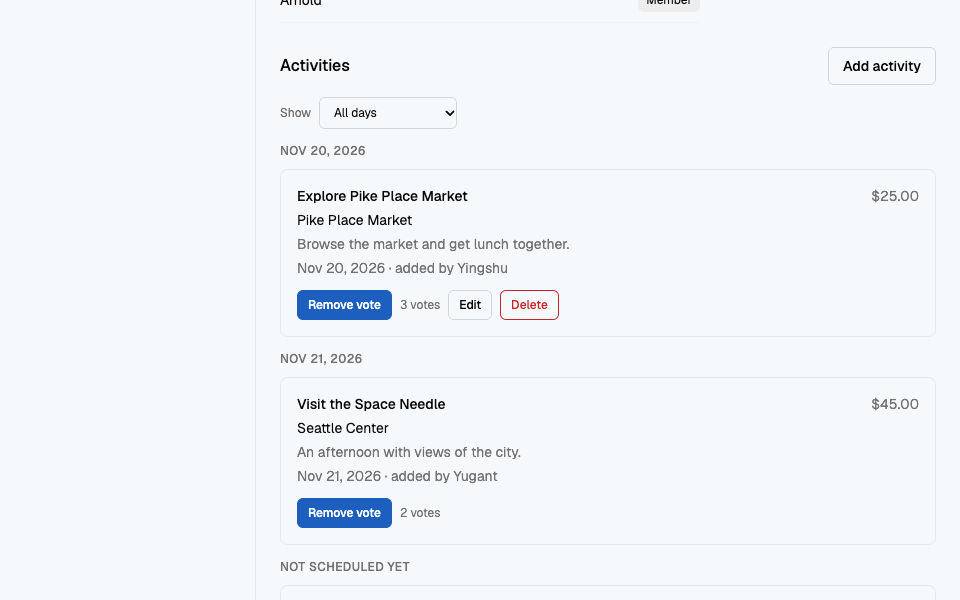
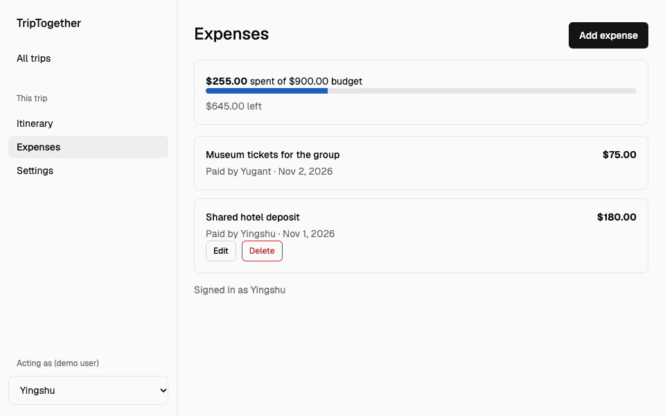

# TripTogether

CodePath WEB103 Final Project

Designed and developed by: Yugant Nagralawala, Arnold Waigwa, and Yingshu Wang

🔗 Link to deployed app: Coming soon — planned deployment on Render.

## About

### Description and Purpose

TripTogether is a full-stack web app that helps friends plan trips together in one shared space. Users can create trips, join a trip, suggest activities, organize a daily itinerary, vote on activities, and record shared expenses. The app helps groups keep travel plans organized and make decisions together without losing important information in group chats.

### Inspiration

Planning a trip with friends often involves scattered messages, separate lists of places to visit, and expense records in different apps. TripTogether brings these details together so that everyone can contribute to the plan and see the latest updates. The project is also inspired by the course’s GOATPath exemplar, which organizes related items into a clear workflow. TripTogether applies that approach to collaborative trip planning.

## Tech Stack

Frontend: React, React Router, HTML, and CSS.

Backend: Node.js and Express with a RESTful API.

Database: PostgreSQL.

Deployment: Render.

## Features

All six core features below are implemented. Each has a demonstration GIF.

### ✅ Google Sign-in

Users sign in with Google through Passport. The server issues a 15-minute JWT in an HTTP-only cookie. Trip pages and APIs require authentication; membership and organizer permissions still apply. The recordings below were made with the previous demo selector.

### ✅ 1. Create and Manage Trips

- [x] Users can create a trip with a title, destination, start date, end date, and budget. They can view trip details, update the information, and delete a trip they organize.

The recording demonstrates browsing trips, creating a trip, editing its budget in Settings, and deleting it.

### ✅ 2. Join Trips and View Members

- [x] Users can join an existing trip using its invitation code and view the trip’s members. Each membership records whether the user is an organizer or a member.

The recording demonstrates Arnold joining the Portland trip with its invitation code and then seeing the member list with roles.

### ✅ 3. Suggest and Manage Activities

- [x] Trip participants can add activities with a title, location, scheduled date, description, and estimated cost. They can view activities and edit or delete their own suggestions.

The recording demonstrates adding an activity, editing its cost, and deleting it. Only the person who added an activity can change it, and scheduled dates must fall within the trip dates.

### ✅ 4. View a Daily Itinerary

- [x] Participants can view activities grouped by day and filter the itinerary by date to find the plans for a specific day.

The recording demonstrates activities grouped by day and the date filter, including a day with nothing planned and the group of unscheduled activities.

### ✅ 5. Vote on Activities

- [x] Participants can vote for activities they want to include and remove their votes. Each activity displays its vote count, with one vote per participant per activity.

The recording demonstrates voting, removing a vote, and a second participant voting, with the count updating each time.

### ✅ 6. Track Shared Expenses

- [x] Participants can record an expense’s description, amount, and payer, view the trip’s total spending compared with its budget, and edit or delete their own expense entries. Automatic debt settlement is outside the initial scope.

The recording demonstrates the budget summary, adding an expense paid by another member, editing it past the budget, and deleting it.

## Initial Technical Plan

### Database Relationships

- One-to-many: A trip has many activities and many expenses. Each activity and expense belongs to one trip.
- Many-to-many: Users can participate in multiple trips, and each trip can have multiple users. A `trip_members` join table connects `users` and `trips` and stores each membership’s role.
- Voting: An `activity_votes` join table connects users and activities. A unique constraint on `(user_id, activity_id)` prevents duplicate votes.

### Backend and API

- Use Express routes and controllers to expose a RESTful API backed by PostgreSQL.
- Support complete activity CRUD with `GET /api/trips/:tripId/activities`, `GET /api/activities/:activityId`, `POST /api/trips/:tripId/activities`, `PATCH /api/activities/:activityId`, and `DELETE /api/activities/:activityId`.
- Add routes for trips, memberships, votes, and expenses as needed for the planned features.
- Include a development database reset/seed script that restores sample users, trips, memberships, activities, votes, and expenses.

### Frontend Structure and Interactions

- Use React Router for a trip list page (`/trips`), a trip details page (`/trips/:tripId`), and an expenses page (`/trips/:tripId/expenses`).
- Redirect users to the new trip’s details page after creating a trip.
- Allow voting and date filtering on the trip details page without navigating away.
- Organize page components such as `TripsPage`, `TripDetailsPage`, and `ExpensesPage`, with reusable components such as `TripCard`, `ActivityList`, `ActivityCard`, and `ExpenseForm`. Page/container components manage data and pass it to presentation components through props.
- Deploy the React frontend and Express backend on Render with a PostgreSQL database. Verify all visible pages, links, forms, and buttons before submission.

### Selected Custom Features

1. **Filtering:** Filter trip activities by date in the daily itinerary.
2. **Server-side validation:** Validate POST and PATCH data before updating PostgreSQL, including required fields, trip date order, activity dates within the trip, positive expense amounts, and nonnegative budgets or estimated costs. Return useful validation messages to the frontend.

### Scope Notes

The app supports Google authentication. Seeded demo accounts remain sample data and cannot be selected as an authenticated identity.

## Installation Instructions

- Server: cd server, npm install, copy .env.example to .env and fill in the PostgreSQL values for your local database, npm run reset, npm run dev (http://localhost:3001)
- Client: cd client, npm install, npm run dev (http://localhost:5173). The client sends /api requests to the server on port 3001.

### Google authentication setup

1. In `server/.env`, set `GOOGLE_CLIENT_ID` and `GOOGLE_CLIENT_SECRET` from a Google OAuth **Web application** client. Configure its consent screen and add your account as a test user while the application is in testing.
2. Register `http://localhost:3001/api/auth/google/callback` as an authorized redirect URI. Set `GOOGLE_CALLBACK_URL` to that exact URI and `CLIENT_URL=http://localhost:5173`.
3. Generate a secret with `openssl rand -hex 32` and put it in `JWT_SECRET`. Keep credentials and secrets out of Git.
4. Run `cd server` then `npm run migrate` to add Google identities to an existing database **without deleting data**. For a fresh development database, `npm run reset` includes the new column but deletes existing app data.
5. Start server and client, open `http://localhost:5173`, and select **Continue with Google**. Restart the server after changing environment variables. Missing OAuth configuration or a short JWT secret prevents startup.

Google identities are matched by Google ID. Existing users with the same email are not automatically linked; a collision fails login. New Google users can join seeded trips using their invitation codes.

Authentication endpoints: `GET /api/auth/google`, `GET /api/auth/google/callback`, `GET /api/auth/me`, and `POST /api/auth/logout`. The demo `x-user-id` header and public `/api/users` listing have been removed. All mutation requests, including logout, must carry an `Origin` header matching `CLIENT_URL`.

For production, set `NODE_ENV=production`, use HTTPS, and set the real callback and client URLs. Serve `/api` through the frontend origin (a reverse proxy), preserving the browser's Origin header; the client uses relative API URLs. Cookies use `Secure` in production and `SameSite=Lax`, so unrelated frontend/backend sites are not supported by this configuration. No proxy trust setting is needed because cookies are explicitly secure in production.

JWTs expire after 15 minutes; users then sign in again. Logout clears the browser cookie, but a copied JWT remains valid until expiration. There are no sessions, refresh tokens, or stored Google access tokens.

Run `cd client && npm run lint && npm run build` for client validation. Manually verify Google consent, cancelled login, page refresh, logout, and joining a trip with two different Google accounts to confirm organizer/member permissions.
