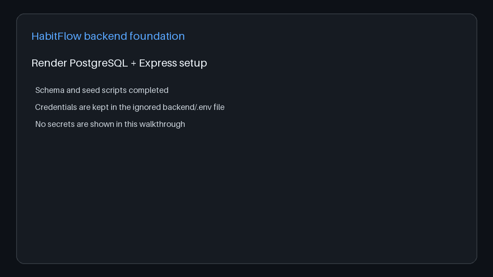
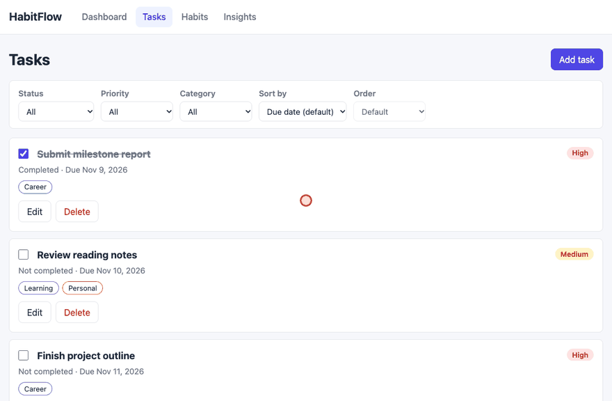

# HabitFlow

Designed and developed by: Mithun Venkatesh Gowda, Bailey Perillo, Anurag Bheemapp

🔗 Link to deployed app:

## About

### Description and Purpose

A full-stack productivity dashboard and habit tracker designed to help users build consistent daily routines, manage tasks efficiently, and receive AI-driven weekly coaching insights, bottleneck analysis, and automated priority suggestions to optimize their personal workflows.

### Inspiration

Inspired by the need for intelligent productivity tools that don't just act as static checklists, but actively provide actionable feedback and data-driven insights on habit formation and time management.

## Tech Stack

Frontend: React, Vite, React Router, CSS

Backend: Node.js, Express.js, RESTful API

Database: PostgreSQL (with one-to-many and many-to-many relationships)

Deployment: Render

## Current Development Progress

Milestone 4 (Unit 8) delivered the full task flow, from the database to the UI:

- React frontend (Vite + React Router) with shared navigation and routes for
  `/`, `/tasks`, `/tasks/:taskId`, `/habits`, `/habits/:habitId`, and `/insights`.
- Tasks page: create, edit, delete, and mark tasks complete, with priority,
  due date, overdue highlighting, and category tags.
- Task details page at `/tasks/:taskId`, with "Task not found." for missing tasks.
- Dashboard with task totals, completed, incomplete, overdue, and completion
  percentage calculated from real data, plus a "Due today and overdue" list.
- Filtering by status, priority, and category, and sorting by due date,
  priority, created date, or title.
- Validation on both the frontend form and the backend API, with clear loading,
  empty, and error states.
- 74 automated backend tests (`npm test`).

Habits and streaks, weekly insights, and deployment are planned for the final
milestone (Unit 9).

### API Reference

| Method | Route | Success | Notes |
| --- | --- | --- | --- |
| `GET` | `/api/health` | `200` | Health check |
| `GET` | `/api/tasks` | `200` | Supports filters and sorting below |
| `GET` | `/api/tasks/:id` | `200` | Includes related `categories` |
| `POST` | `/api/tasks` | `201` | Requires `title` and an existing `user_id` |
| `PATCH` | `/api/tasks/:id` | `200` | Partial update; `due_date: null` clears the date |
| `DELETE` | `/api/tasks/:id` | `204` | No response body |
| `GET` | `/api/categories` | `200` | All categories, sorted by name |

Task fields: `title` (non-empty string), `description` (string),
`priority` (`low`, `medium`, `high`), `due_date` (`YYYY-MM-DD` or `null`),
`completed` (`true`/`false`), `category_ids` (array of existing category ids;
replaces the task's categories, `[]` removes them), and `user_id` (create only).

List query parameters:

```text
GET /api/tasks?completed=false
GET /api/tasks?priority=high
GET /api/tasks?category=Learning
GET /api/tasks?sort=due_date            # due_date | priority | created_at | title
GET /api/tasks?sort=title&order=desc    # order is optional: asc | desc
```

Error responses use the shape `{ "error": "message" }`: `400` for invalid IDs,
fields, query parameters, or malformed JSON; `404` for missing tasks; and `500`
only for unexpected server failures.

## GitHub Project Management

Repository: https://github.com/HabitFlowProject/web103_finalproject

Project board: https://github.com/orgs/HabitFlowProject/projects/2

### Completed Unit 7 Issues

- [#6 Complete HabitFlow planning documents](https://github.com/HabitFlowProject/web103_finalproject/issues/6)
- [#7 Create and configure HabitFlow project board](https://github.com/HabitFlowProject/web103_finalproject/issues/7)
- [#8 Present HabitFlow pitch and record feedback](https://github.com/HabitFlowProject/web103_finalproject/issues/8)

### Completed Unit 8 Issues

- [#1 Implement task REST API CRUD](https://github.com/HabitFlowProject/web103_finalproject/issues/1) ✅
- [#2 Create PostgreSQL schema and seed data](https://github.com/HabitFlowProject/web103_finalproject/issues/2) ✅
- [#3 Build Dashboard and Tasks pages](https://github.com/HabitFlowProject/web103_finalproject/issues/3) ✅
- [#5 Add validation, filtering, sorting, and error handling](https://github.com/HabitFlowProject/web103_finalproject/issues/5) ✅

The backend foundation walkthrough shows the health check and seeded task
response without exposing database credentials.



### Planned for the Final Milestone (Unit 9)

- [#4 Implement habits and completion streaks](https://github.com/HabitFlowProject/web103_finalproject/issues/4)

## Features

### ✅ User Dashboard Overview:

A centralized analytics view displaying daily completion rates, active habit streaks, and productivity scores.

Completed in Unit 8: task totals, completed, incomplete, overdue, and completion
percentage from real data, plus a "Due today and overdue" list where tasks can
be completed without leaving the page. Habit streaks are added in Unit 9.


### ✅ Habit & Task CRUD Management:

Full create, read, update, edit, and delete capabilities for managing daily habits, recurring tasks, and completion logs.

Completed in Unit 8 for tasks: create and edit in a modal form, mark complete,
delete with confirmation, and a task details page. Habit CRUD is added in Unit 9.



### ✅ Category Tagging System (Many-to-Many):

Organize habits and tasks into custom categories (e.g., Health, Career, Learning) with a join table allowing flexible categorization.

Tasks can be tagged with any number of categories through the `task_categories`
join table, and tags are shown on every task.


### AI Weekly Coaching & Insights Panel:

A dedicated view where users receive automated, LLM-generated summaries and recommendations based on their weekly habit completion patterns.

Planned feature; a walkthrough will be added after implementation.

### ✅ Interactive Filtering & Sorting:

Filter tasks and habits by completion status, priority level, or category tags.

Tasks can be filtered by status, priority, and category, and sorted by due
date, priority, created date, or title. Filters are kept in the URL.


### ✅ Data Validation & Error Handling:

Robust backend validation on all POST and PATCH requests to ensure clean data input and graceful error messaging across the UI.

The task form checks the title, priority, and due date before saving, and the
API rejects invalid input with a `400` and a clear message. The UI shows
loading, empty, and error states, including "Task not found." for missing tasks.


## Installation Instructions

### Backend

```bash
cd backend
npm install
npm run db:schema
npm run db:seed
npm start
```

The backend requires a local ignored `.env` file containing the Render
PostgreSQL connection variables:

```env
PGUSER=
PGPASSWORD=
PGHOST=
PGPORT=5432
PGDATABASE=
NODE_ENV=development
PORT=3000
```

Do not commit `.env` or database credentials.

### Frontend

With the backend running on port 3000, in a second terminal:

```bash
cd frontend
npm install
npm run dev
```

Open http://localhost:5173. In development, Vite forwards `/api` requests to
`http://localhost:3000`.

### Backend Tests

The task API tests use Node's built-in test runner (Node 22 or newer) against
a dedicated local PostgreSQL database. The tests drop and recreate every table
on each run, so they refuse to start unless the database name ends in `_test`
and the host is not on Render.

```bash
createdb habitflow_test
cd backend
cp .env.test.example .env.test   # fill in local credentials; ignored by Git
npm test
```

Values in `backend/.env.test` take priority over `backend/.env` during tests,
so the development and Render databases are never touched.
