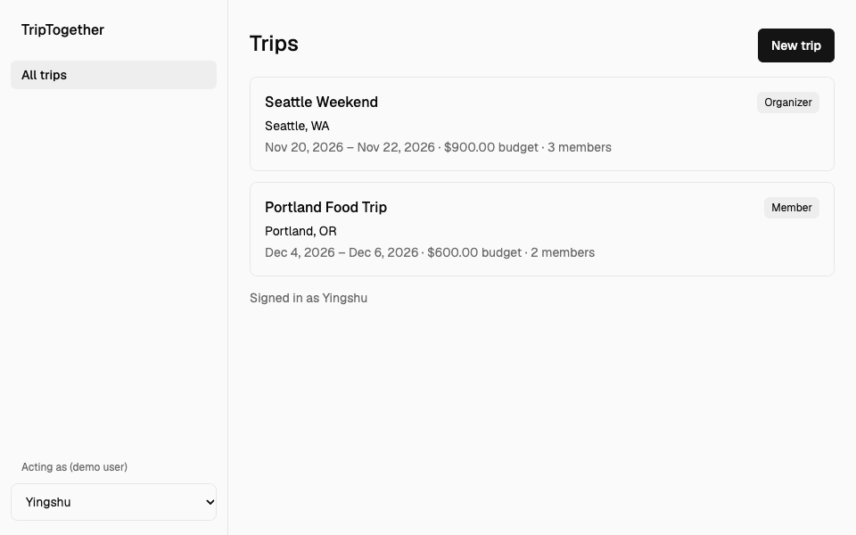
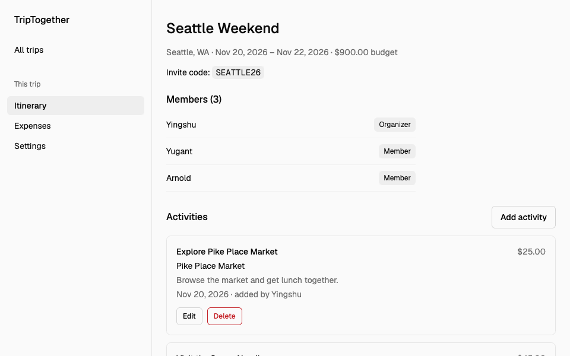

# TripTogether

CodePath WEB103 Final Project

Designed and developed by: Yugant Nagralawala, Arnold Waigwa, and Yingshu Wang

🔗 Link to deployed app: [TripTogether](https://triptogether-web103-yingshu.onrender.com)

## About

### Description and Purpose

TripTogether is a full-stack web app that helps friends plan trips together in one shared space. Users can create trips, join a trip, suggest activities, organize a daily itinerary, vote on activities, and record shared expenses. The app helps groups keep travel plans organized and make decisions together without losing important information in group chats.

### Inspiration

Planning a trip with friends often involves scattered messages, separate lists of places to visit, and expense records in different apps. TripTogether brings these details together so that everyone can contribute to the plan and see the latest updates. The project is also inspired by the course’s GOATPath exemplar, which organizes related items into a clear workflow. TripTogether applies that approach to collaborative trip planning.

## Tech Stack

Frontend: React, React Router, HTML, and CSS.

Backend: Node.js and Express with a RESTful API.

Database: PostgreSQL.

Deployment: Render.

## Features

All six core features below are implemented. Each has a demonstration GIF.

### ✅ GitHub Sign-in

Users sign in with GitHub through Passport. Sessions are stored in PostgreSQL with an HTTP-only session cookie. Trip pages and APIs require authentication; membership and organizer permissions still apply. The recordings below were made with the previous demo selector.

### First-login starter trip

When a new GitHub user signs in for the first time, the app creates **Your first
trip**, a three-day Seattle sample trip starting seven days later, with a $300
budget and three sample activities. The new user is its organizer and owns the
activities, so they can edit or delete the sample content and invite friends.
Activities are labeled as samples in their descriptions.

The user, identity, trip, membership and activities are created in one transaction.
Repeated or simultaneous sign-ins do not create duplicate starter trips. Existing
GitHub users are left unchanged; deleting the starter trip does not recreate it
on the next login. No new database migration or reset is needed for this feature.
Demonstrate it with a GitHub account that has never signed into this database;
clearing cookies or signing out of an existing account does not make it a new user.
This feature still needs a demonstration GIF for final submission.

### Request feedback and loading states

Trip, activity, and expense create/update/delete actions show success toasts;
joining, voting, and logout also show feedback. API and connection errors show
an error toast, with form errors retained beside the inputs. Notifications
survive page navigation, can be dismissed, and pause their timeout on hover or
keyboard focus.

Page loading and active requests use accessible spinners, with reduced-motion
support. Request buttons and form inputs are disabled until the request and
refresh finish; a synchronous mutation guard also prevents repeated submissions.
Other mutation controls and activity-pane dismissal are locked during a pending
request. Non-request controls such as notification dismissal remain available.
The new feedback features still need a demonstration GIF for final submission.

### ✅ 1. Create and Manage Trips

- [x] Users can create a trip with a title, destination, start date, end date, and budget. They can view trip details, update the information, and delete a trip they organize.

The recording demonstrates browsing trips, creating a trip, editing its budget in Settings, and deleting it.

### ✅ 2. Join Trips and View Members

- [x] Users can join an existing trip using its invitation code and view the trip’s members. Each membership records whether the user is an organizer or a member.

The recording demonstrates Arnold joining the Portland trip with its invitation code and then seeing the member list with roles.

### ✅ 3. Suggest and Manage Activities

- [x] Trip participants can add activities with a title, location, scheduled date, description, and estimated cost. They can view activities and edit or delete their own suggestions.

The recording demonstrates adding an activity, editing its cost, and deleting it. Only the person who added an activity can change it, and scheduled dates must fall within the trip dates.

### ✅ 4. View a Daily Itinerary

- [x] Participants can view activities grouped by day and filter the itinerary by date to find the plans for a specific day.

The recording demonstrates activities grouped by day and the date filter, including a day with nothing planned and the group of unscheduled activities.

### ✅ 5. Vote on Activities

- [x] Participants can vote for activities they want to include and remove their votes. Each activity displays its vote count, with one vote per participant per activity.

The recording demonstrates voting, removing a vote, and a second participant voting, with the count updating each time.

### ✅ 6. Track Shared Expenses

- [x] Participants can record an expense’s description, amount, and payer, view the trip’s total spending compared with its budget, and edit or delete their own expense entries. Automatic debt settlement is outside the initial scope.

The recording demonstrates the budget summary, adding an expense paid by another member, editing it past the budget, and deleting it.

## Initial Technical Plan

### Database Relationships

- One-to-many: A trip has many activities and many expenses. Each activity and expense belongs to one trip.
- Many-to-many: Users can participate in multiple trips, and each trip can have multiple users. A `trip_members` join table connects `users` and `trips` and stores each membership’s role.
- Voting: An `activity_votes` join table connects users and activities. A unique constraint on `(user_id, activity_id)` prevents duplicate votes.

### Backend and API

- Use Express routes and controllers to expose a RESTful API backed by PostgreSQL.
- Support complete activity CRUD with `GET /api/trips/:tripId/activities`, `GET /api/activities/:activityId`, `POST /api/trips/:tripId/activities`, `PATCH /api/activities/:activityId`, and `DELETE /api/activities/:activityId`.
- Add routes for trips, memberships, votes, and expenses as needed for the planned features.
- Include a development database reset/seed script that restores sample users, trips, memberships, activities, votes, and expenses.

### Frontend Structure and Interactions

- Use React Router for a trip list page (`/trips`), a trip details page (`/trips/:tripId`), and an expenses page (`/trips/:tripId/expenses`).
- Redirect users to the new trip’s details page after creating a trip.
- Allow voting and date filtering on the trip details page without navigating away.
- Organize page components such as `TripsPage`, `TripDetailsPage`, and `ExpensesPage`, with reusable components such as `TripCard`, `ActivityList`, `ActivityCard`, and `ExpenseForm`. Page/container components manage data and pass it to presentation components through props.
- Deploy the React frontend and Express backend on Render with a PostgreSQL database. Verify all visible pages, links, forms, and buttons before submission.

### Selected Custom Features

1. **Filtering:** Filter trip activities by date in the daily itinerary.
2. **Server-side validation:** Validate POST and PATCH data before updating PostgreSQL, including required fields, trip date order, activity dates within the trip, positive expense amounts, and nonnegative budgets or estimated costs. Return useful validation messages to the frontend.

### Scope Notes

The app supports GitHub authentication. Seeded demo accounts remain sample data and cannot be selected as an authenticated identity.

## Installation Instructions

Use Node 22 (the version in `.node-version`); Node 20.19+ is also supported locally.
Run all commands below from the repository root.

1. Install both apps with `npm run setup`.
2. Configure `server/.env` using the GitHub authentication steps below. Keep an existing `.env`; do not overwrite it with the example.
3. For the existing shared database, run `npm run migrate --prefix server`. Do not reset the shared database.
4. In one terminal run `npm run dev:server`; in another run `npm run dev:client`.
5. Open `http://localhost:5173`. The frontend forwards `/api` to the backend on port 3001. The client command fails if 5173 is occupied instead of silently changing the OAuth callback port.

### Setup for each teammate

- Pull the latest code and run `npm run setup` when dependencies change.
- Configure a local `server/.env` with a valid `DATABASE_URL`, GitHub client ID/secret, and your own random `SESSION_SECRET`. You can share a development OAuth App's credentials privately or each register a local OAuth App. GitHub account passwords are never shared.
- Keep local `CLIENT_URL=http://localhost:5173` and `GITHUB_CALLBACK_URL=http://localhost:5173/api/auth/github/callback` and register that callback in your chosen OAuth App.
- If using the shared Render database from your computer, its external connection URL and an allowed current public IP are required. Each teammate's IP must be allowed independently; using the same database URL does not bypass the database's network rules.
- Migrations are repeatable and preserve data. Only use `npm run reset --prefix server` for a fresh, dedicated development database whose application data can be deleted.
- Each teammate signs in using their own GitHub account. New users have separate trip memberships; create a trip or join with an invitation code to collaborate.

For the deployed website, teammates only need the live link and their own GitHub account. They do not need `.env`, database access, or client secrets to use the website.

### Render deployment

See [the deployment guide](docs/deployment.md) for the single Web Service settings,
production OAuth configuration, environment variables, and verification steps.
Express serves the built client and `/api` from the same URL in production.

### GitHub authentication setup

1. Register a GitHub OAuth App with homepage `http://localhost:5173` and callback `http://localhost:5173/api/auth/github/callback`.
2. Copy `server/.env.example` to `server/.env` only if you do not already have a local configuration. Set `DATABASE_URL` to your database's external connection URL for local development, and fill in `GITHUB_CLIENT_ID` and `GITHUB_CLIENT_SECRET`.
3. Generate `SESSION_SECRET` with `openssl rand -hex 32`. Set `CLIENT_URL=http://localhost:5173`. Keep all secrets out of Git.
4. Run `cd server` then `npm run migrate`. This adds the one-to-one `user_github_accounts` table and PostgreSQL session storage, allows users without email, and preserves existing application data. A fresh development database can use `npm run reset`, which deletes existing application data.
5. Start server and client, then open `http://localhost:5173` and choose **Continue with GitHub**. Use port 5173 consistently; Vite forwards `/api` requests to the backend on 3001.

Each GitHub identity creates a separate user. Existing demo users are not automatically linked by email. New users can create trips or join seeded trips with `SEATTLE26` or `PORTLAND26`.

Sessions are stored in PostgreSQL, with a seven-day cookie containing only a signed session ID. Logout deletes the server session. GitHub access and refresh tokens are not stored. Production requires HTTPS, `NODE_ENV=production`, a production `CLIENT_URL` and matching registered callback URL. The server trusts one reverse proxy and uses secure cookies in production.

### Validation

From the repository root, run `npm test` and `npm run lint --prefix client`.
`npm test` builds the frontend, runs the React feedback tests, and runs the server
authentication/production routing tests. Manually verify real GitHub authorization,
cancelled login, page refresh, logout, return to a protected page, and two users
joining/voting with separate accounts. To demonstrate pending controls and spinners,
throttle the network in browser developer tools, submit once, and try clicking again.

To test starter-trip signup and concurrency against PostgreSQL, run
`RUN_DATABASE_TESTS=1 node --test server/tests/starter-trip.test.js` from the root.
It uses a disposable schema on the configured database and removes it afterward;
it does not reset or modify the application's public tables. The database user
must have permission to create a schema. This integration test is skipped during
ordinary builds so Render builds do not depend on access to a live database.
