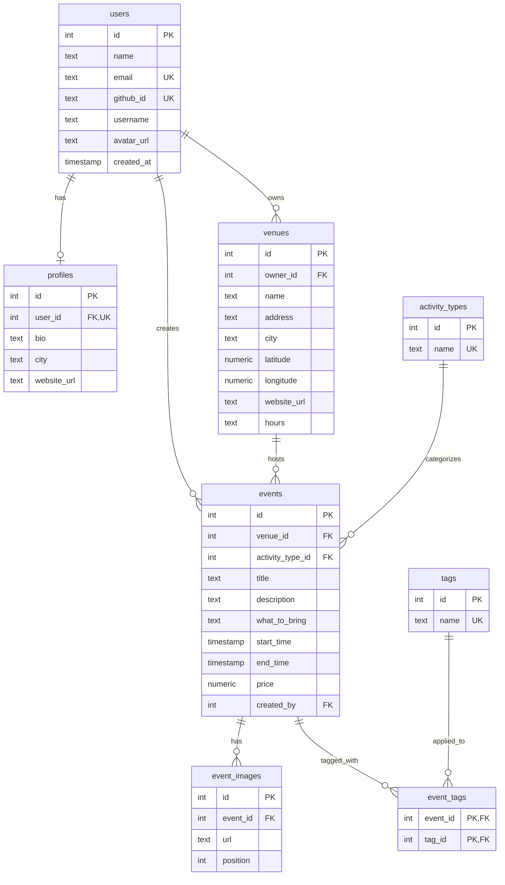

# Entity Relationship Diagram

Reference the Creating an Entity Relationship Diagram final project guide in the course portal for more information about how to complete this deliverable.

## Create the List of Tables

- **users**: business owners and event organizers who log in to manage listings
- **profiles**: each user's public profile (bio, city, website), one-to-one with users
- **venues**: independent creative spaces (studios, shops, cafes, bookstores) owned by a user
- **events**: workshops and gatherings hosted at a venue
- **activity_types**: the single activity type for each event (Workshop, Open Mic, Class, ...), which powers the "All activity types" filter
- **tags**: descriptive labels shared across events (pottery, beginner-friendly, kid-friendly, ...)
- **event_tags**: join table that links events and tags (many-to-many)
- **event_images**: photos shown in the event page carousel

## Add the Entity Relationship Diagram

### users

| Column Name | Type | Description |
|-------------|------|-------------|
| id | integer | primary key |
| name | text | display name of the owner/organizer |
| email | text | unique contact email (optional; GitHub may not share it) |
| github_id | text | unique GitHub account id, set on first GitHub login |
| username | text | GitHub username |
| avatar_url | text | GitHub profile picture |
| created_at | timestamp | account creation time |

### profiles

| Column Name | Type | Description |
|-------------|------|-------------|
| id | integer | primary key |
| user_id | integer | foreign key → users.id; UNIQUE, so each user has at most one profile (one-to-one) |
| bio | text | short "about me" |
| city | text | where the user is based |
| website_url | text | personal or business site |

### venues

| Column Name | Type | Description |
|-------------|------|-------------|
| id | integer | primary key |
| owner_id | integer | foreign key → users.id |
| name | text | venue name |
| address | text | street address |
| city | text | city |
| latitude | numeric | used to calculate distance from the user |
| longitude | numeric | used to calculate distance from the user |
| website_url | text | external link (validated URL) |
| hours | text | operating hours |

### events

| Column Name | Type | Description |
|-------------|------|-------------|
| id | integer | primary key |
| venue_id | integer | foreign key → venues.id |
| activity_type_id | integer | foreign key → activity_types.id |
| title | text | event name |
| description | text | "What you'll do" section |
| what_to_bring | text | "What to bring" section |
| start_time | timestamp | event date and start time |
| end_time | timestamp | event end time |
| price | numeric | admission cost (0 = Free); the $ / $$ / $$$ tier is derived from it |
| created_by | integer | foreign key → users.id; only this user can edit or delete the event |

### activity_types

| Column Name | Type | Description |
|-------------|------|-------------|
| id | integer | primary key |
| name | text | unique activity type name (e.g., Workshop) |

### tags

| Column Name | Type | Description |
|-------------|------|-------------|
| id | integer | primary key |
| name | text | unique tag name |

### event_tags

| Column Name | Type | Description |
|-------------|------|-------------|
| event_id | integer | primary key (composite), foreign key → events.id |
| tag_id | integer | primary key (composite), foreign key → tags.id |

### event_images

| Column Name | Type | Description |
|-------------|------|-------------|
| id | integer | primary key |
| event_id | integer | foreign key → events.id |
| url | text | image URL in cloud storage |
| position | integer | display order in the carousel |
